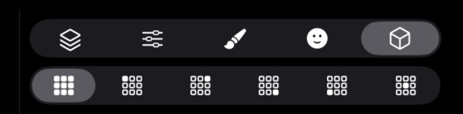
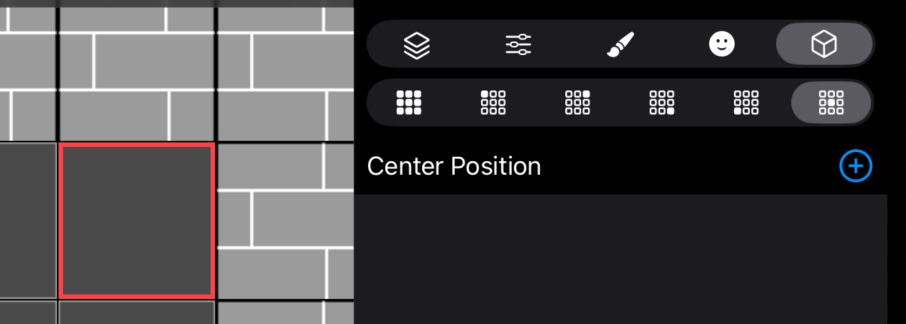
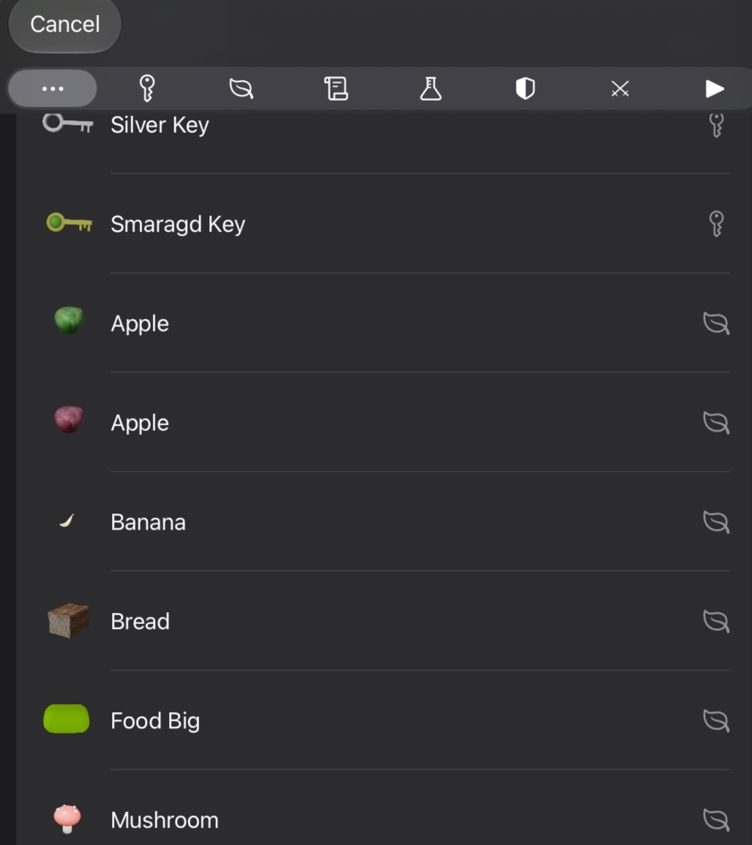
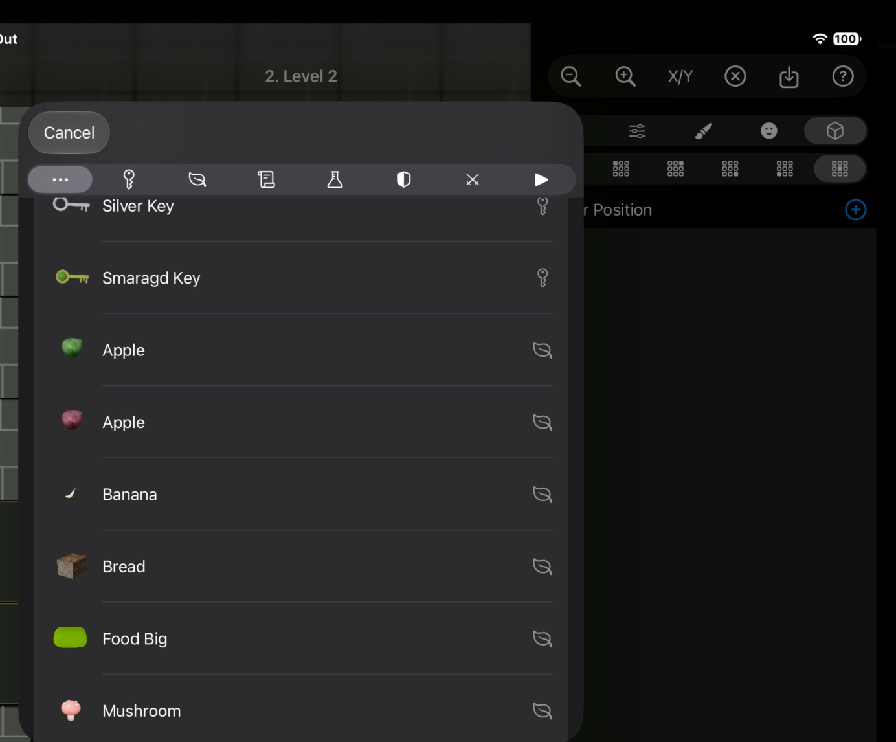
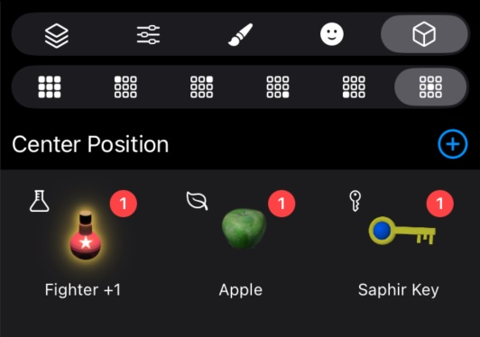
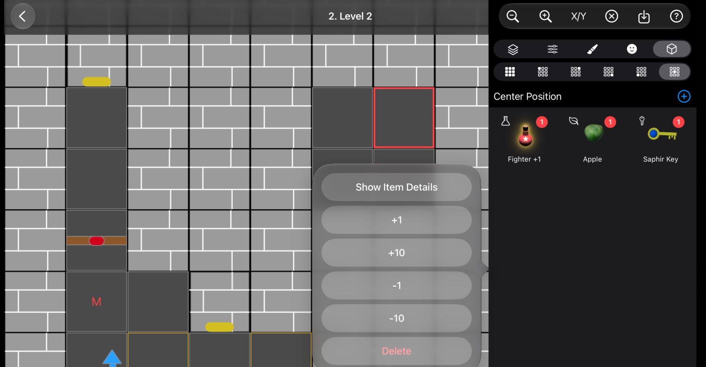
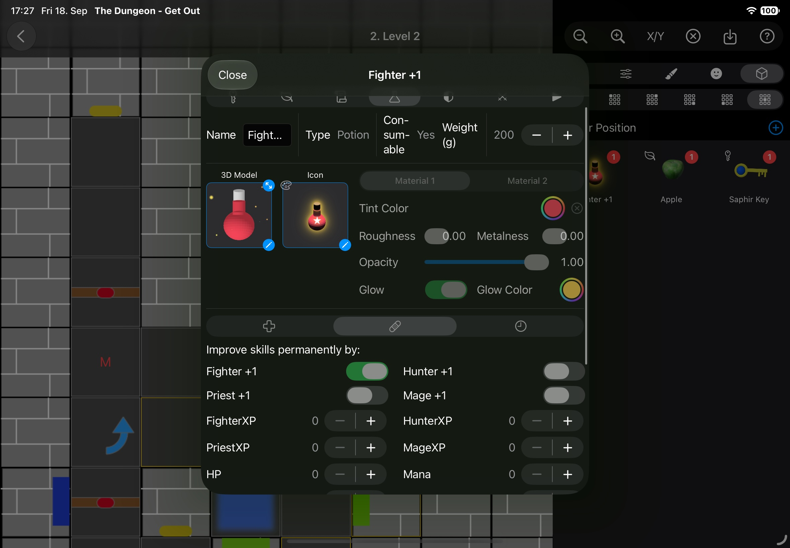

Game items such as keys, food, potions, weapons, and treasure bring your dungeon to life and provide essential gameplay elements for players to discover and collect.

## Item Positioning

You can choose between 5 different placement positions on a tile:

- **Center**: Places the item in the middle of the tile
- **Top Left**: Places the item in the upper left corner
- **Top Right**: Places the item in the upper right corner
- **Bottom Left**: Places the item in the lower left corner
- **Bottom Right**: Places the item in the lower right corner

Multiple items can be placed on the same tile, either at the same position or distributed across different positions. The first button of the position bar shows the items of **all** positions; to add an item, select the position it should go to. Tiles that hold their items in one spot (alcovens, chests) have no position bar.

## Add an Item

Items can be placed on various tile types including:
- **Closed pits**
- **Floor switches**
- **Deactivated teleports**
- **Empty tiles**
- **Alcovens**
- **Chests**

If you see a __+__ button after selecting a tile and a position, that tile type supports item placement.

### Item Selection

When you click the __+__ button, the item selection dialog opens. At the top of the dialog, you'll find a filter bar that lets you filter items by category:

 |  | 

Categories include keys, food, potions, weapons, armor, and other item types. This makes it easy to find exactly what you're looking for.

## Adjust Item Quantity

To change the quantity of an item:

1. Tap on the placed item
2. A popup will appear allowing you to adjust the quantity
3. Set the desired number of items

## Item Levels

Potions that restore or cure (healing, mana, stamina, the cures, the temporary potions) and potion bombs come in **levels 1 to 6**. A higher level makes the same item stronger: more hitpoints or mana restored, more poison, freeze or fear time removed, a longer boost, a harder-hitting bomb — up to three times the effect at level 6. The level shows on the item's icon from level 2 up, and as a roman numeral in its name (*Mana Potion IV*).

To change the level, tap the placed item and choose **Level +1** or **Level −1**. Every place that holds items offers this — tiles, chests, monster classes and individual monsters. Items of different levels are kept apart, so a chest can hold a level 1 and a level 4 healing potion side by side. Items from older level packs are level 1.

*Hitpoints Potion Big*, *Mana Potion Big* and *Stamina Potion Big* are no longer offered: use the normal potion at level 2 or higher instead. Packs that already contain them keep working.

## View Item Details

You can also open the item detail screen to see:

- **Item type**: What category the item belongs to
- **Effects**: What the item does when used or equipped
- **Attributes**: Stats and properties of the item

This helps you understand exactly what players will receive when they find this item in your dungeon.

**[Back to Tutorial Overview](/ETMEditorTutorials/ETMEditorTutorials)**
