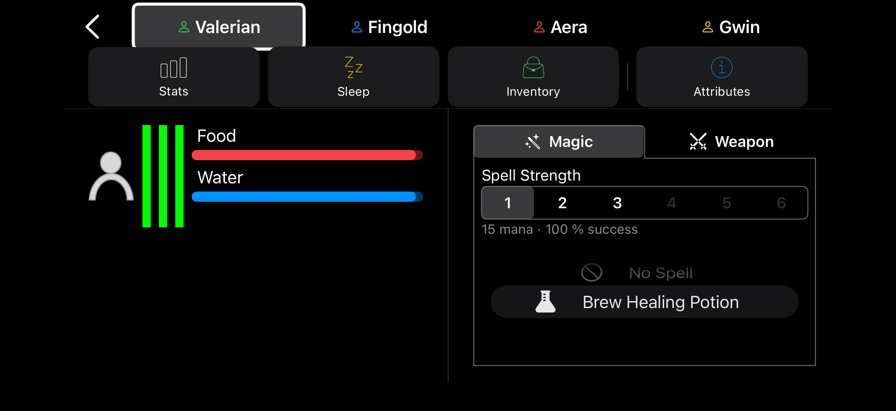
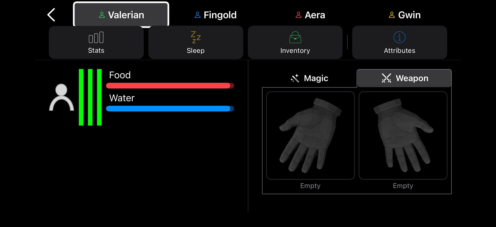

The November 2026 update R4.11 - November 2026 for "The Dungeon - Get Out" and the corresponding Level Editor is now **officially released**!

Last month gave your party a whole bag of new tricks. This update makes magic deeper: you decide how much power goes into every spell, your mage can brew potions instead of waiting to find them, and the monsters play by the same rules. On Apple TV, the Siri Remote alone is now enough to play.

## Spell Strength

Every spell can now be cast at a **spell strength from 1 to 6**. A stronger spell costs more mana and, in return, deals more damage or lasts longer — that goes for attack spells, curses, support spells, Light, Open Door and the restore spells alike. The selector sits right above the spells, and the line below it tells you what the cast will cost and how likely it is to work.

Because success is no longer guaranteed: your hero's **wizardry** and **faith**, together with practice in the spell's element, decide the **success chance**. A failed cast fizzles, still costs its mana and gives no experience. A hero's **mana pool** limits how high they can go — strength levels above it are greyed out, so a young mage starts small and grows into the bigger spells.

Spells also got their own balance: every spell now has its **own mana cost and recovery time**. Bolts are the cheap staple, area and party-wide spells cost more and take longer to recover, and Light and Darkness are cheap utilities.

## Brew Your Own Potions

Six new **brewing spells** turn mana into potions: a **healing**, **mana** or **speed potion**, or a cure against **poison**, **freezing** or **fear**. The caster needs an **empty flask** — the one a drunk potion leaves behind — and the potion is brewed at the strength you cast it with. No flask, no potion, and no mana spent. Brewing costs more than casting the matching spell directly, but it lets you prepare for a fight and keep your mana for the attacks when it starts. Each brewing spell is learned from its own scroll.

That works because **potions and bombs now come in levels**. A higher-level potion heals or boosts more, a higher-level cure removes more of a curse, and a higher-level bomb hits harder and freezes, poisons or frightens for longer.

## Tougher Monsters, Tougher Priests

The monsters cast by the same rules as your party: they **regain mana** over time, even in a fight, and each spell comes with its own **cooldown**, so a monster mage paces itself instead of firing the same spell over and over.

When a spell hits your party, it now matters **where it bursts**: a bolt that explodes in front of you hurts the **front row much more than the back row**, a fallen front hero no longer shields anyone, and every hero's damage is rolled separately against their own resistance.

In return, **priests** grow tougher: every priest level raises all four **magic resistances**, up to 30 % from levels alone — equipment and spells add more on top.

## A Reworked Hero Sheet

The hero sheet now has a clear **Magic | Weapon** tab with a framed content area: Magic for the spell strength and the spells, Weapon for what each hand holds.

On **iPad and Mac**, the bigger screen is put to use: in weapon mode the two hands sit side by side, each with the item's **damage, class, ammo, spell, charges and armor** next to it, and in magic mode the selected spell's **description and effect** at the chosen strength appear beside the selector.

On **Apple Watch**, the hero detail is quicker to reach: tap the top of the screen and it opens directly on the hero's stats, and one swipe further is a **Menu page** with the map, sleep, save and the main menu.

## Apple TV: Play with the Siri Remote

A game controller is still the most comfortable way to play on Apple TV, but it is no longer required: the **Siri Remote** now does everything. Swipe up and down to walk and left and right to turn; a click uses what lies in front of you or attacks with the next ready hero; Play/Pause picks which hero attacks (or opens the map); a long click opens the hero detail; and every menu and dialog follows the remote. A new **Siri Remote tutorial** shows how it all works — with a controller connected, the game asks which one you want to learn.

**Save games on Apple TV** are now stored in **iCloud**, so they are no longer lost when the system clears local storage. The **Lite version** shares its iCloud save games with the full version.

## Smaller Touches

- A **key that doesn't fit** a door, lock or chest now tells you so with a message and a sound, instead of doing nothing
- **Chests creak open** with their own sound
- **Smoother graphics** in large levels — one of the bigger test levels went from 38 to 60 frames per second
- On the **unfolded iPhone**, the game uses the iPad layout

## In the Level Editor

The new magic is ready for your own levels — in the **standalone Level Editor** and in the editor built into the game alike:

- **Spell strength 1–6** for spell triggers and for monster classes that cast spells
- **Item levels**: set the level of potions and bombs in monster inventories and on tiles, and of the item a trigger spawns
- The **brewing spells** and their learning scrolls are available for your levels
- New level packs start their heroes with **40 mana**, matching the new balance where a hero's mana limits how strong a spell can be cast
- The item picker no longer offers the old big potions — use a **potion level** instead
- Your levels play with the game's **new magic rules**: every spell has its own mana cost and recovery time, and monsters regain mana

And as usual, both the game and the editor come with a round of **stability improvements and bug fixes**.

---

Thank you for playing! More adventures await in the maze. Development is still ongoing — stay tuned for the next updates!

  

    
  
Download the Game

  

  

    
    
Download the Level Editor

  

